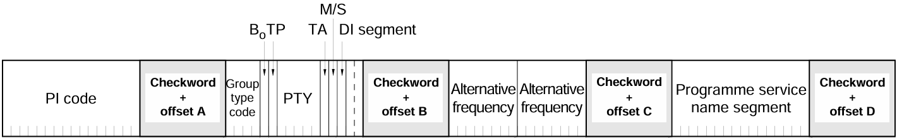
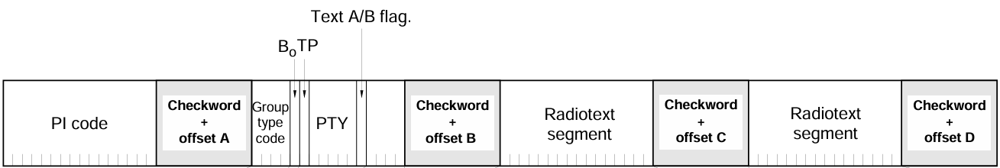

# BMS Project - RDS

**Author**: Adam Zvara (xzvara01)

# Introduction

The Radio Data System (RDS) is a communications protocol standard used in FM radio to send small amounts of information along with the regular audio signal. Generally, it improves the listening experience by providing details like the radio station’s name, messages, or traffic updates. RDS also makes it easier for radios to switch to better frequencies or deliver special announcements. This system is widely used, especially in Europe, to make FM radio more useful and user-friendly. There are many types of messages used in RDS. This project covers only two types, which are **0A** and **2A**.

Group 0A in the RDS system is used primarily for transmitting **basic station information** and includes:
  - Program Identification (PI): A unique code that identifies the radio station (16-bits).
  - Program Type (PTY): A code that classifies the type of content being broadcast, such as news, sports, or music (5-bits).
  - Traffic Program (TP) and Traffic Announcement (TA): Flags that indicate whether the station carries traffic information (TP) and if a traffic announcement is currently being broadcast (TA).
  - Alternative Frequencies (AF): A list of other frequencies where the same station can be found (16-bit chunks).
  - Program Service (PS) Name: An 8-character text string that displays the station's name on the receiver's screen (16-bit chunks).

The group 0A message is  in four 104-bit chunks. Each chunk consists of in 26-bit blocks, which include 16 bits of actual data and a 10-bit CRC code for error checking. The image below shows the structure of the group 0A message.
The first block in every chunk contains the PI code, while the second block carries general information with the chunk position (2-bit segment number) within the message. This helps the receiver correctly piece together the message even if the parts are received out of order. The third block contains (up to) two alternative frequencies and the fourth block sends two characters of the Program Service (PS) name. Because of this, it takes four parts to send all the AFs and PS characters.
<br>


<br>

The primary use of the 2A group message in RDS is to **transmit contextual messages**, which can include information such as the song title, artist name, station information, or other messages intended for the listener. The RT message contains some of the same information as the group 0A message (PI code, PTY and TP), but it also includes:
  - A/B: Flag used to indicate whether the Radio Text (RT) has been updated.
  - Radio Text (RT): Contains the actual text message (64 characters).

The structure is similiar to the group 0A message (see image below). The first block contains the PI code, the second block carries general information with the chunk position within the message, and the third and fourth block contain the RT message. Since we can send up to 64 characters, it takes 16 parts to send the whole message (that's why the segment is 4 bits long in this type).
<br>


<br>

# Error detection

The **CRC (Cyclic Redundancy Check)** in each block of an RDS chunk is a 10-bit code used to detect errors during transmission. The CRC is calculated using a polynomial defined by the RDS standard. The process works as follows:
  1. The 16-bit data portion of the block is treated as a binary number.
  2. This binary number is divided (using modulo-2 arithmetic) by a predefined generator polynomial: x^10 + x^8 + x^7 + x^5 + x^4 + x^2 + x + 1.
  3. The remainder of this division is XORed with the block identifier to ensure unique position of block in the chunk.

The block identifiers are constants provided by the standard:
  - A (1st block): `0011111100` = 252
  - B (2nd block): `0110011000` = 408
  - C (3rd block): `0101101000` = 360
  - D (4th block): `0110110100` = 436

If a block is received in an error-free manner, the CRC will be zero. If the CRC is not zero, the block contains an error and should be discarded. Additionally, if the block is received out of order (and is transmitted correctly), 
we can use the block identifier to determine its correct position in the chunk.

# Implementation

The goal of this project is implementation of a simple RDS encoder and RDS decoder in C++. The encoder should be able to take a message and encode it into RDS chunks, while the decoder should be able to take RDS chunks and decode them into the original message. The encoder and decoder should be able to handle both group 0A and group 2A messages. 

## Argument parsing

Encoder and decoder take different parameters (encoder even takes different parameters based on group type). The parameters are not in usual format, as flag is defined as a single dash with multiple letters, so I couldn't use `getopt`. I've decided to implement a simple parser, located in `src/argparse_*`. Argument parsing is **similiar to python's `argparse` module**. First you define program arguments with `add_argument()` function (which is overloaded for different types of arguments and has a function parameter which is used for storing the parsed value to your variable). Then you call `parse_args()` function to parse the arguments. The parser also implements validation of arguments (e.g. checks if 16-bit PI is in range and valid number, etc.). One unusual thing about my solution is storing alternative frequencies - I've decided to store them in a **vector of integers (supports 1-8 AFs)** instead of floating point numbers, as I think it's easier to work with them in this format. During the parsing phase, the parser removes the decimal point from the frequency and subtracts 875 to get the value used directly for encoding (e.g. `94.5` is stored as `70`). Other functions include `find_argument_value()` which returns the value of the argument with given flag and is used to get the group type before parsing any other arguments (as they depend on the group type) and `find_help_flag()` which looks for help flag in the arguments and prints usage information.

<br>
<br>

## RDS types

The structures/types/functions concerning RDS are separated from the encoding and decoding logic and are split into three separate files:
  - `src/rds_*` - contains `RDS_shared` structure, which holds the shared data between both groups (PI, PTY, TP), type definitions for RDS message parts (`RDS_chunk/block/data/CRC`) and functions, which are independent of the group type.
  - `src/group0A_*` - contains `RDS_group0A` structure, which expands the shared structure to group 0A (AF, PS, MS, ...), functions for working with group 0A message blocks.
  - `src/group2A_*` - contains `RDS_group2A` structure, which expands the shared structure to group 2A (A/B, RT), functions for working with group 2A message blocks.

Since this is a small project I've decided to keep things simple and implement basic operations over RDS blocks using functions. Let's take a closer look at `src/rds_*` files. These files contain basic functions for working
with the RDS blocks, such as `RDS_calculate_CRC`, which **returns CRC** of given data block (16-bits) or `RDS_encode`, which takes 16-bit data block and returns full RDS block (32-bits, concatenates CRC XORed with block id). It also contains functions for determining block id from the block data (`RDS_get_block_type -> A/B/C/D`) and determining message group type from a chunk (`RDS_get_message_type -> 0A/2A`). Block id is determined from a block by **separately calculating CRC of the data section** and trying to XOR it with **all possible block** ids to see if any of them match the CRC of the whole block. Message group type is done by **determining block types for all blocks within a chunk** (`RDS_process_chunk` - also verifies the integrity of all blocks), selecting second block in correct order and extracting the group type from it.
Lastly, it contains two pairs of function for encoding and decoding general RDS blocks:
  - `RDS_uint16_encode` takes 16-bit value and returns encoded RDS block and `RDS_uint16_decode` takes RDS block and returns 16-bit value extracted from it. This is useful for encoding/decoding PI code for both groups.
  - `RDS_2uint8_encode` and `RDS_2uint8_decode` are same as previous functions but for two 8-bit values. This is useful for encoding/decoding AFs, PSs, RTs.

Files `src/group0A_*` and `src/group2A_*`, apart from defining group specific structures, also contain functions for defining B blocks (second blocks from start), since these contain information closely related to the group type (PTY, TA, MS, segments, etc.). I've decided to split the encoding function into two parts:
  - `RDS_g*a_groupB_init` - takes the structure of the group and returns initialized **data block** (does not contain segment number or CRC yet)
  - `RDS_g*a_groupB_encode` - takes the output of previous function with segment and returns **full RDS block** (with segment number and CRC added)
There are also `RDS_g*a_groupB_decode` functions, which take RDS block and return the structure of the group with the data extracted from the block.

## RDS encoder

First uses parser to get group type from arguments and load group specific arguments to proper group structure (<br>`|PS string| > 8` or `|AF| > 8` or `|RT| > 64` the **program does not truncate** expandable variables but ends with error). Before encoding blocks, the encoder expands the PS/RT to length of 8/64 characters (expands with spaces if shorter). The alternative frequencies are also padded to 8 elements (with `0`s if shorter). These **padded values** are also **sent in a message**, making the size of 0A messages always `4*104` bits long and 2A messages `16*104` bits long. The first block is encoded using general uint16 encoding function, the second block is encoded using group specific function, and the third and fourth blocks are encoded using general 2uint8 encoding function. The blocks are then concatenated into chunks and printed to the output.

## RDS decoder

First uses parser to read binary blob (and validates it). The whole message is split into chunks (104-bits long). The first chunk is used to determine the group type. If there are **more than 4 or 16 chunks for 0A or 2A message** respectively, the program ends with an error. Before the actual decoding, the flexible sized variables (PS, RT, AF) are padded with spaces/`0` to ensure we can deal with missing chunks inside the message (for string types PS and RT they are printed as spaces, for AFs they are not printed at all). The chunks are then processed one by one - each chunk is decoded, check if CRCs for all blocks within chunk are correct and the information is stored in the group structure (at position given by the segment number). The decoder **does not check for inconsistencies** in the message (e.g. if the PI code is the same in all chunks, if the PTY is the same in all chunks, etc.). After the decoding is done, the program prints the group structure.

# Challenges

Not really any big challenges. Maybe only that I've really tried to overcomplicate things by doing classes with inheritance, which ended up as only using class constructors which I've decided to switch for basic functions.

# Testing

I've developed my own tests using `pytest` module in `rds_test.py`. The tests include:
  - Testing the argument parser with different invalid arguments (non-existent/redundant/missing flags, invalid/missing arguments, larger than specified length).
  - Testing the RDS encoder/decoder with arguments provided by assignment.
  - Testing encoder with multiple frequencies, short PS strings, missing PS/AF chunks, invalid CRC at various positions, scrambled chunks, scrambled blocks, scrambled chunks + blocks
  - Testing decoder with multiple frequencies, short RT strings, missing chunks RT, invalid CRC at various positions, scrambled chunks, scrambled blocks, scrambled chunks + blocks

```
============================== test session starts ===============================
platform linux -- Python 3.9.2, pytest-8.3.3, pluggy-1.5.0
rootdir: /root/proj
collected 18 items

rds_test.py ..................                                              [100%]

=============================== 18 passed in 5.75s ===============================
```